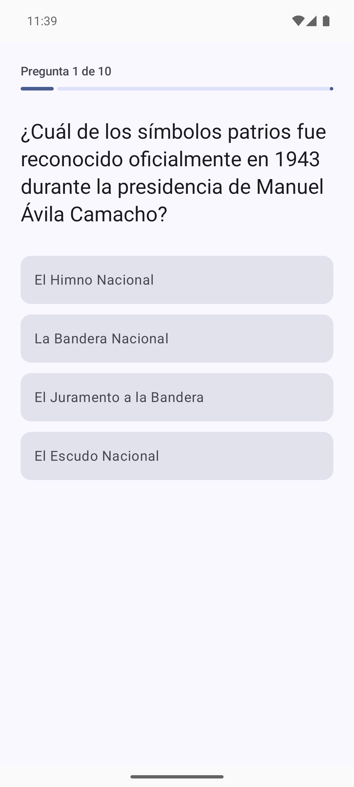
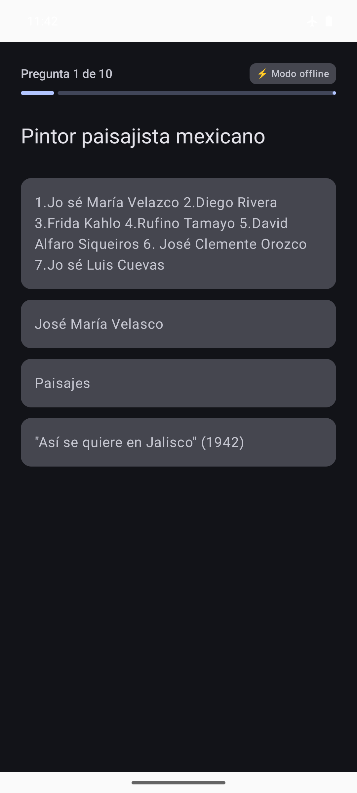
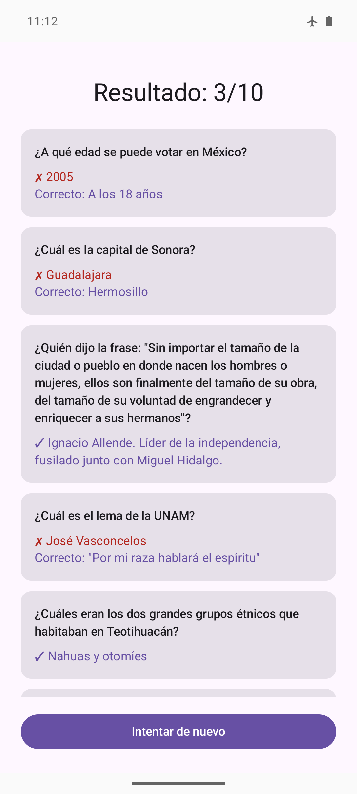

# Mexamen

Android-приложение (Compose Multiplatform, Kotlin) — квиз для подготовки к экзамену на натурализацию в Мексике (гражданство через SRE). Экзамен сдаётся на испанском; приложение — тоже полностью на испанском.

| Квиз (LLM-дистракторы) | Оффлайн-режим, тёмная тема | Результат |
|---|---|---|
|  |  |  |

## Какая задача решается

Официальный гид подготовки — ~800 пар «вопрос → ответ» сплошным текстом в 13 разделах ([источник](https://ruspansky.com/guia-de-estudios/)). По такому списку неудобно готовиться: нет самопроверки и формата «выбери ответ», как на реальном экзамене. Mexamen превращает гид в квиз: 10 случайных вопросов, 4 варианта ответа, мгновенная проверка и разбор ошибок.

## Как участвует AI

У вопросов гида есть только правильный ответ — неправильных вариантов не существует. Их генерирует AI, двумя механизмами:

- **LLM** — DeepSeek `deepseek-chat` за интерфейсом `LlmProvider`. Один батч-запрос на весь квиз: для каждого вопроса модель получает вопрос, правильный ответ и контекст, возвращает строгий JSON с 3 правдоподобными дистракторами. Ответ валидируется поэлементно (ровно 3, без совпадений с верным ответом и между собой, case/accent-insensitive).
- **RAG** — собственный, без фреймворков и vector-DB. Эмбеддинги всех вопросов посчитаны оффлайн (Ollama `nomic-embed-text`, 768-dim) и лежат в ассетах (`embeddings.bin`, ~2.4 MB). На устройстве — косинусный top-K полным перебором в памяти. RAG-соседи дают LLM контекст («для вопроса о столице штата — столицы других штатов»), а их ответы служат fallback-дистракторами.

```
┌──────────── Оффлайн (машина разработчика) ────────────┐
│ scrape_guia.py ─► questions.json ─► build_embeddings.py│
│      (гид, ~776 пар)      (Ollama) ─► embeddings.bin   │
└───────────────────────┬───────────────────────────────┘
                        │ commit в composeResources/files
┌────────── Приложение (Android, commonMain) ──▼────────┐
│ QuizViewModel ─► BuildQuizUseCase                      │
│    ├─ QuestionPicker (10 случайных, ≤2 на раздел)      │
│    ├─ VectorStore (cosine top-8) ──► RAG-контекст      │
│    ├─ DistractorGenerator ─► LlmProvider ─► DeepSeek   │
│    └─ RagFallback (ответы соседей — без сети/ключа)    │
└───────────────────────────────────────────────────────┘
```

**Graceful degradation:** при любой ошибке LLM (нет сети, нет ключа, таймаут 30 с, кривой JSON) квиз работает на fallback-дистракторах из RAG-соседей — с бейджем «⚡ Modo offline». Частично невалидный ответ LLM закрывается fallback-ом поэлементно.

## Запуск пайплайна данных

Одноразово, на машине разработчика (артефакты закоммичены):

```bash
pip install -r tools/requirements.txt
python tools/scrape_guia.py        # гид → tools/out/questions.json (+ кэш HTML)
ollama pull nomic-embed-text       # нужен запущенный Ollama
python tools/build_embeddings.py   # → tools/out/embeddings.bin (+ самопроверка top-K)
# затем скопировать оба файла в composeApp/src/commonMain/composeResources/files/
```

## Сборка и запуск

```bash
# Ключ DeepSeek (опционально — без него квиз работает в fallback-режиме):
echo 'DEEPSEEK_API_KEY=sk-...' >> local.properties

./gradlew :composeApp:assembleDebug        # APK: composeApp/build/outputs/apk/debug/
./gradlew :composeApp:testDebugUnitTest    # юнит-тесты
```

Ключ не хранится в git: `local.properties` (или env `DEEPSEEK_API_KEY`) → `BuildConfig`. Требования: Android 8.0+ (API 26), интернет — только для LLM-дистракторов.

Ручные интеграционные смоуки с реальным ключом (не для CI):

```bash
RUN_DEEPSEEK_SMOKE=1 ./gradlew :composeApp:testDebugUnitTest --tests '*SmokeTest*'
```

## Реальные варианты ответов (real-answers-plan, F1…I1)

Дистракторы, где возможно, — не LLM-генерация, а реальные неверные варианты, взятые с test-страниц ruspansky.com (WATU-квиз, test-1…test-10) и сматченные с `questions.json` по тексту вопроса. LLM по-прежнему генерирует только неверные варианты — но с реальными как контекст-примеры стиля, а не с ответами RAG-соседей "вслепую" (H1). Формулировка верного ответа тоже иногда варьируется между гидом и test-страницей — обе хранятся, и при сборке квиза показывается случайная (`answerVariants`, G2).

Покрытие (776 вопросов):

| Источник дистракторов | Вопросов | Комментарий |
|---|---|---|
| `realDistractors` (реальные, с test-страниц) | 657 | 656 сматчены автоматически/вручную (F1+F2) |
| `syntheticDistractors` (LLM, офлайн, разово) | 119 | нет test-страницы для вопроса (F3) |
| **Итого с ≥3 дистракторами без обращения к рантайм-LLM** | **776 / 776** | |
| `answerVariants` с альтернативной формулировкой (>1 варианта) | 155 | остальные 621 — один вариант (совпадает с гидом) |

Приоритет источника дистракторов без LLM (`RagFallback`, G3): свои `realDistractors` → соседские `realDistractors` → свои `syntheticDistractors` → ответы RAG-соседей (последний резерв, случай отсутствует при текущем покрытии 776/776, но код на него рассчитан).

**Статус ручной проверки:** юнит-тесты зелёные (57 тестов, 0 падений — прирост с 45 на MVP за счёт F–H), включая сборку промпта/валидацию LLM-ответа против `answerVariants` и `context`-примеров (H2). Живой прогон на эмуляторе (ключ DeepSeek + авиарежим) в этой рабочей среде не завершён — эмулятор (`mexamen-test`, Android 36 x86_64) не может пройти собственную загрузку System UI без аппаратной акселерации (нет доступа к `/dev/kvm`, пользователь не в группе `kvm`); ANR возникает до открытия приложения. Нужно прогнать чек-лист на реальном устройстве или ускоренном эмуляторе:
1. Ключ DeepSeek в `local.properties` → квиз → дистракторы правдоподобны, включая реальные.
2. Повторный запуск квиза → у вопросов с >1 `answerVariants` формулировка верного ответа иногда меняется.
3. Авиарежим → бейдж «Modo offline», квиз проходится целиком на fallback-дистракторах.

## Критерии приёмки (spec §10) — выполнено 2026-07-18

1. ✅ `assembleDebug` собирает APK; ставится и запускается на эмуляторе (API 36, minSdk 26).
2. ✅ Квиз 10 × 4 варианта; с ключом DeepSeek LLM-дистракторы получили **10/10** вопросов (`DistractorSmokeTest`, порог ≥ 8).
3. ✅ В авиарежиме квиз запускается и проходится целиком; бейдж «Modo offline» на вопросах и результате.
4. ✅ Экран результата: счёт X/10, разбор с правильными ответами; повторный запуск даёт другой набор вопросов.
5. ✅ Юнит-тесты зелёные: **45 тестов, 0 падений** (retrieval, промпт, парсинг/валидация LLM, fallback, репозиторий).
6. ✅ README (этот файл): задача, роль AI (LLM + RAG, схема), пайплайн данных, сборка.

## Структура

- `mvp-spec.md` — что строим и зачем (SDD, источник истины MVP); `mvp-plan.md` — задачи и порядок MVP.
- `tools/` — Python-пайплайн данных (скрейпер, эмбеддинги).
- `composeApp/src/commonMain` — data / domain / llm / ui, бизнес-логика без Android-зависимостей.
- `composeApp/src/commonTest`, `androidUnitTest` — тесты (kotlin-test, Ktor MockEngine).
